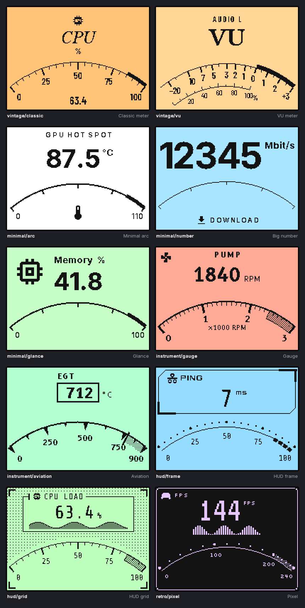

# VU Studio

**Configure your Streacom VU1 dials in minutes — show any hardware, network or software data with custom e-ink faces and RGBW lighting.**

🇮🇹 [Leggi in italiano](README.it.md)

> Status: **early development**. The design is set; the modules are being built. See [the roadmap](docs/roadmap.md).

VU Studio replaces the official VU-Server with a single application that:

* talks **directly to the VU1 hub**, with no separate server or API keys,
* reads **this PC**: CPU, GPU, RAM, disks, network, fans and power through LibreHardwareMonitor, plus HWiNFO when it is running,
* reads **your LAN**: other PCs, Unraid, Steam Deck, Raspberry Pi and NAS through the VU Studio Agent, Glances or Prometheus, plus the router (UPnP) and ping,
* reads **software and online data**: a real audio VU meter, now playing, game FPS, weather, crypto, Home Assistant, MQTT, any JSON API, your own scripts and a local push API,
* designs **e-ink faces** from themes (vintage, minimal, instrument, sci-fi HUD) or in a visual editor with a pixel-exact 1-bit preview,
* drives the **RGBW backlight** by value (gradients, thresholds), with effects, alarms and sync (Windows accent color, album art),
* adds **automatic profiles**, page rotation, history charts and night/standby behaviour,
* runs as a Windows service with a tray app, plus an optional web panel for your phone or other PCs.



## Documentation

* [Requirements](docs/requirements.md)
* [Architecture](docs/architecture.md)
* [VU1 hub serial protocol](docs/vu1-protocol.md)
* [Roadmap](docs/roadmap.md)

## Building from source

Requirements: .NET 10 SDK. Node.js 22 is also needed once the web UI lands.

```bash
dotnet build VuStudio.slnx
dotnet test --project tests/VuStudio.Tests
```

## License

VU Studio is free software, licensed under the [GNU General Public License v3.0 or later](LICENSE).

* Bundled fonts are under the SIL Open Font License.
* Icons come from Material Design Icons (Pictogrammers).
* Brand logos in the icon set are trademarks of their respective owners.

See [`src/VuStudio.Rendering/Assets/README.md`](src/VuStudio.Rendering/Assets/README.md).

VU Studio is a community project. It is not affiliated with Streacom or Karanović Research.
