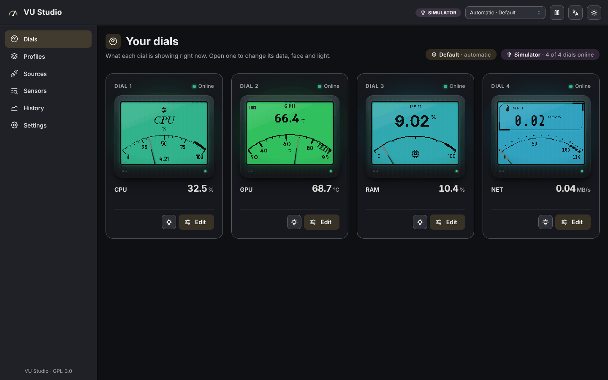
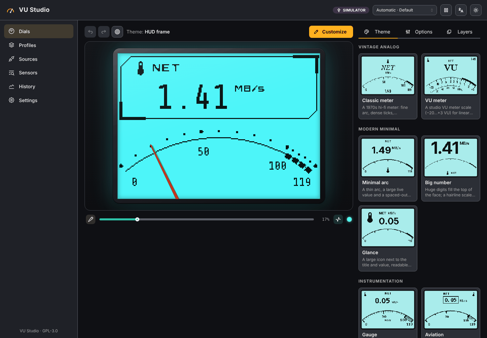
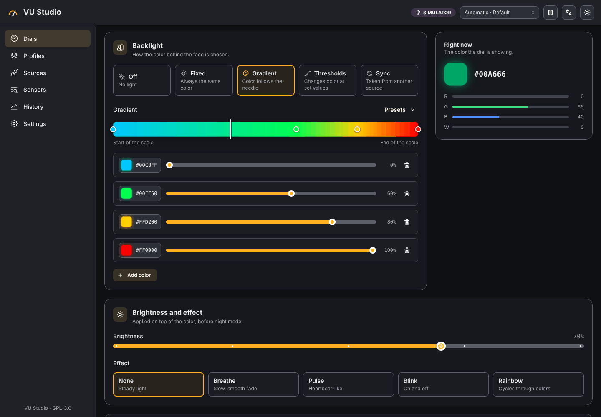
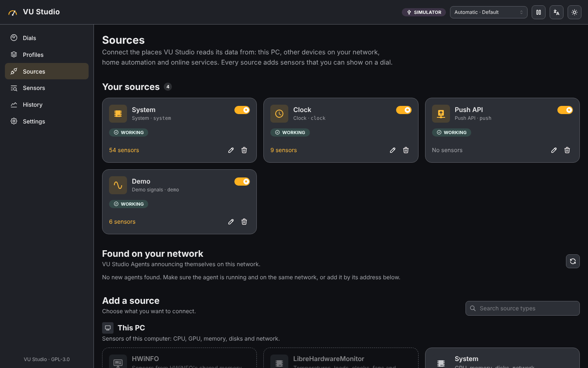
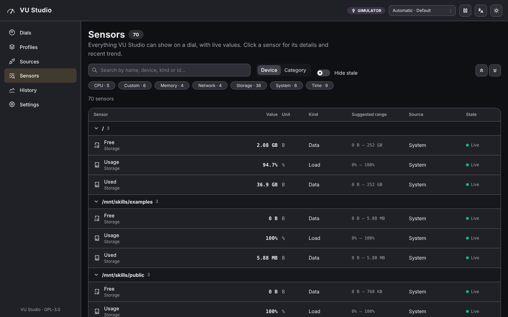
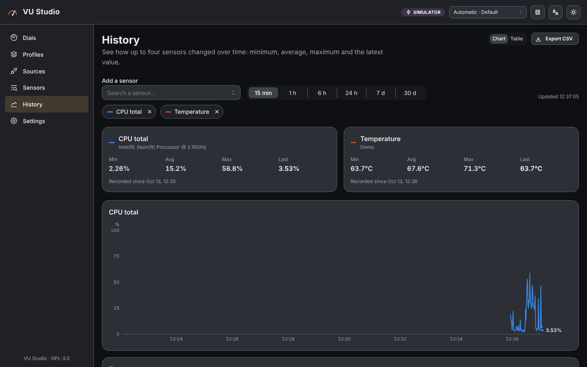
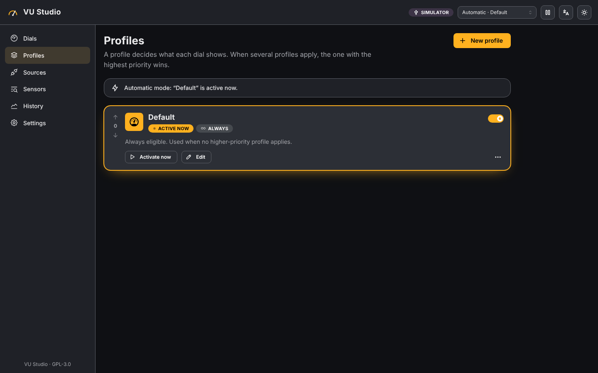
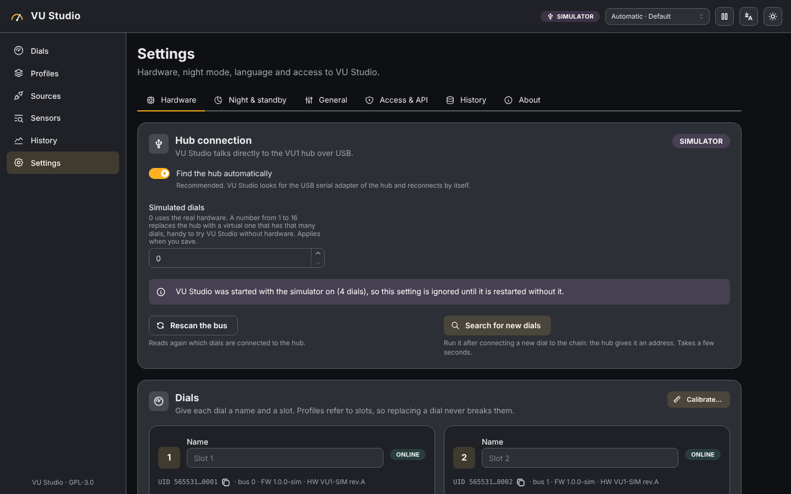
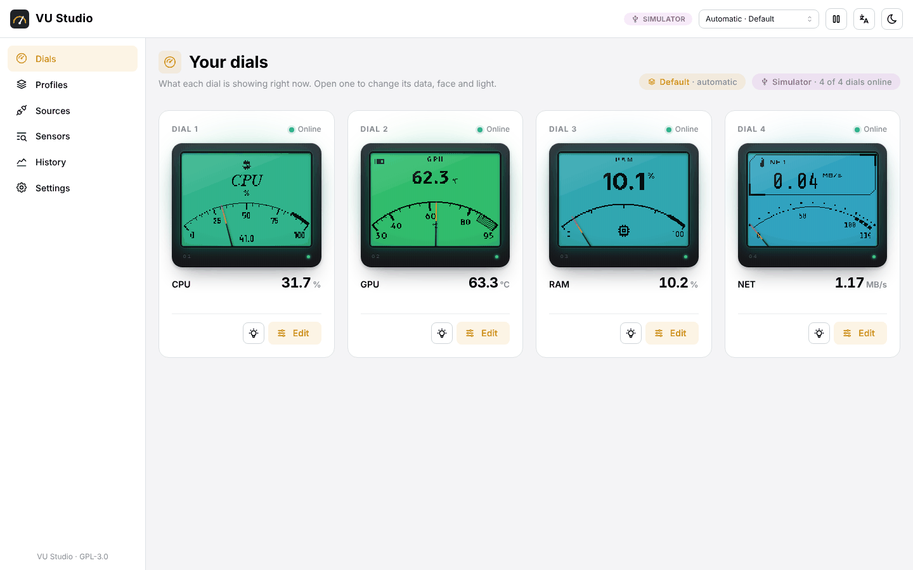
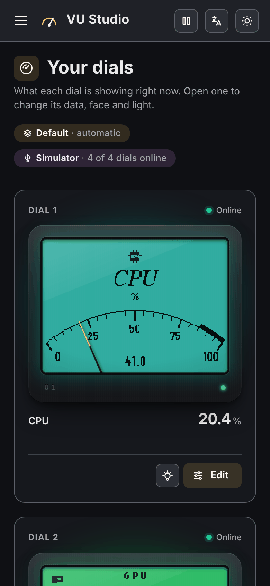

# VU Studio

**An open-source app to configure Streacom VU1 dials: show hardware, network or software data with custom e-ink faces and RGBW lighting.**

🇮🇹 [Leggi in italiano](README.it.md)



> **Status: early alpha.** Most of VU Studio has been tested with a dial simulator and automated tests. Testing on real Windows hardware has just started. Expect rough edges and please [report what you find](https://github.com/blinkone/VU-Studio/issues). See [the roadmap](docs/roadmap.md).

## Why this exists

I have four Streacom VU1 dials on my Windows PC. I found the official VU-Server too complicated to configure and too limited for what I wanted to show, so I built the app I wanted for my own use. Other VU1 owners might find it useful, so it is public and free.

**This project is vibecoded.** It was written with an AI coding assistant (Claude Code). I directed the design, decided what it should do and tested it, but I did not write the code by hand. The full source code is in this repository so anyone can read it, review it and build it themselves. Code reviews and bug reports are very welcome.

## Download

Get the latest installer (`VuStudio-Setup-x.y.z.exe`) from [Releases](https://github.com/blinkone/VU-Studio/releases). Each release also has the Agent for Linux and Windows, SHA-256 checksums and the source code archive.

* The installer is not code-signed yet, so Windows SmartScreen will warn you. Choose *More info → Run anyway*.
* Close VU-Server before starting VU Studio: only one program can use the hub's COM port.
* Logs: `C:\ProgramData\VU Studio\logs` (service) and `%LocalAppData%\VU Studio\logs` (tray app).

## What it does

* Talks **directly to the VU1 hub** over USB serial: no separate server, no API keys.
* Reads **this PC**: CPU, GPU, RAM, disks, network, fans and power through LibreHardwareMonitor, plus HWiNFO when it is running.
* Reads **software data**: a real audio level meter, now playing, the foreground app and game FPS (RivaTuner).
* Reads **your LAN**: other PCs, Unraid, Steam Deck, Raspberry Pi and NAS through the VU Studio Agent, Glances or Prometheus, plus the router (UPnP) and ping.
* Reads **online and home automation data**: weather, crypto, Home Assistant, MQTT, any JSON API, your own scripts and a local push API.
* Designs **e-ink faces** from themes (vintage, minimal, instrument, sci-fi HUD) or in a visual layer editor with a pixel-exact 1-bit preview.
* Drives the **RGBW backlight** by value (gradients, thresholds), with effects, alarms and sync (Windows accent color, album art).
* Adds **automatic profiles** (for example while a game runs), page rotation, history charts and night/standby mode.
* Runs as a Windows service with a tray app. The web UI, in English and Italian, also opens from your phone on the LAN if you enable it.

## Screenshots

All screenshots use the built-in dial simulator (`--simulate 4`).

| | |
|---|---|
|  **Face editor**: pick a theme or customize every layer, with a live 1-bit preview. |  **Backlight**: color by value with gradients or thresholds, effects and alarms. |
|  **Sources**: this PC, LAN devices, home automation and online services. |  **Sensors**: every value with live readings, searchable. |
|  **History**: charts with min, average and max, CSV export. |  **Profiles**: switch what the dials show based on the running app, the time or a sensor. |
|  **Settings**: hub, dials, calibration, night mode and access. |  **Light mode** |

<p align="center"></p>

### Built-in e-ink themes


## Documentation

* [Requirements](docs/requirements.md)
* [Architecture](docs/architecture.md)
* [VU1 hub serial protocol](docs/vu1-protocol.md)
* [HTTP and WebSocket API](docs/api.md)
* [VU Studio Agent for Unraid, Steam Deck and Linux](deploy/agent/README.md)
* [Roadmap](docs/roadmap.md)

## Building from source

Requirements: .NET 10 SDK and Node.js 22.

```bash
(cd web && npm ci && npm run build)      # web UI, output in src/VuStudio.Server/wwwroot
dotnet build VuStudio.slnx
dotnet test --project tests/VuStudio.Tests

# Try it without hardware: four simulated dials, UI at http://127.0.0.1:5341
dotnet run --project src/VuStudio.Server -- --simulate 4
```

Windows packages (installer and Agent binaries) are built by `build/publish.ps1` / `build/publish.sh` and, on a `v*` tag, by the release workflow.

## Acknowledgements and prior work

* **[VU-Server](https://github.com/SasaKaranovic/VU-Server)** by Saša Karanović (Karanović Research) is the official software for the VU1 and the reference this project is based on. I learned the hub's serial protocol by reading its source code (see [the protocol notes](docs/vu1-protocol.md)). VU Studio is a new implementation in C# and TypeScript: it does not include VU-Server's code, and it is not a fork. Thank you for keeping it open.
* The VU1 dials and hub are designed by Streacom and Karanović Research. VU Studio is an independent community project and is not affiliated with either.
* VU Studio is not the first app for the VU1 and does not claim to be. If you know of an existing project whose work should be credited here, please [open an issue](https://github.com/blinkone/VU-Studio/issues) and I will add it.

## License

VU Studio is free software, licensed under the [GNU General Public License v3.0 or later](LICENSE).

* Bundled fonts are under the SIL Open Font License.
* Icons come from Material Design Icons (Pictogrammers).
* Brand logos in the icon set are trademarks of their respective owners.

See [`src/VuStudio.Rendering/Assets/README.md`](src/VuStudio.Rendering/Assets/README.md).

VU Studio is a community project. It is not affiliated with Streacom or Karanović Research.
